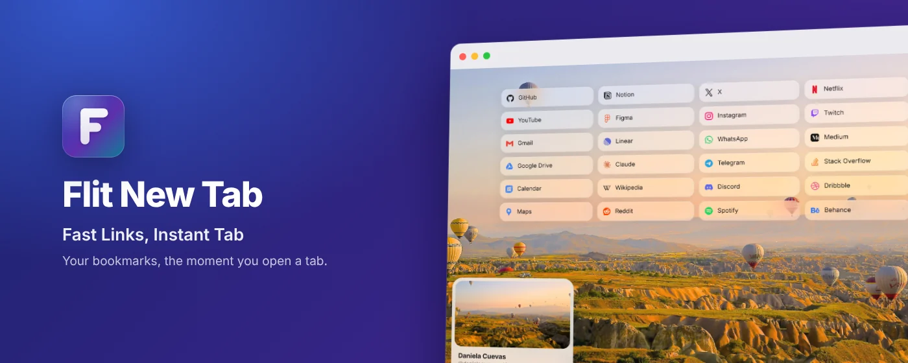
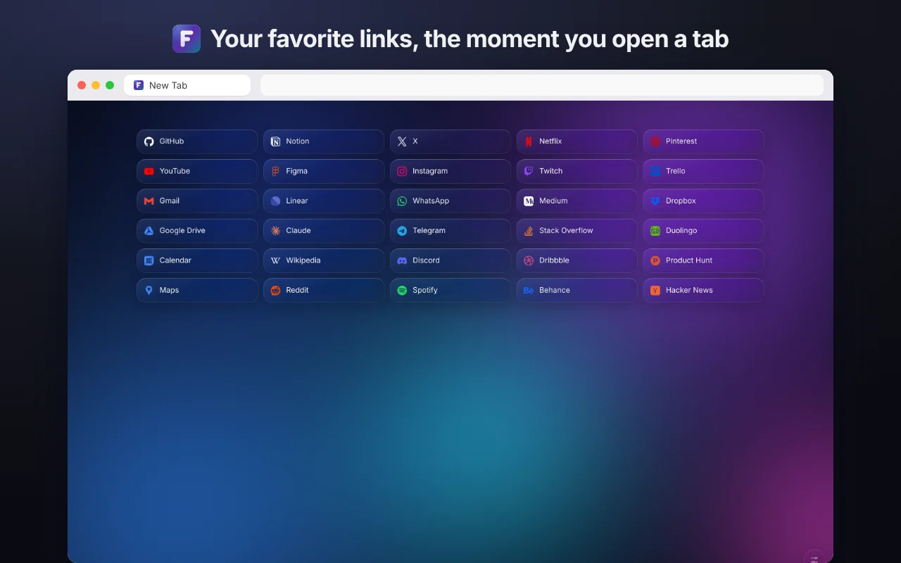
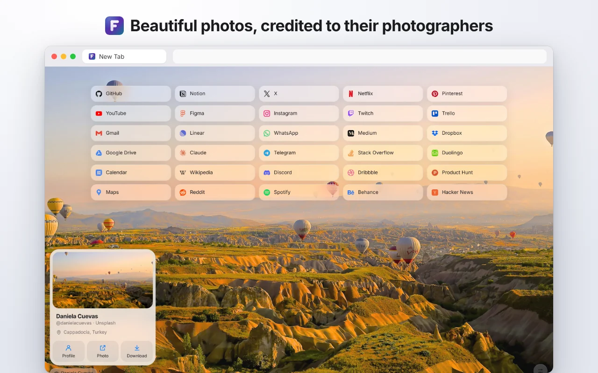
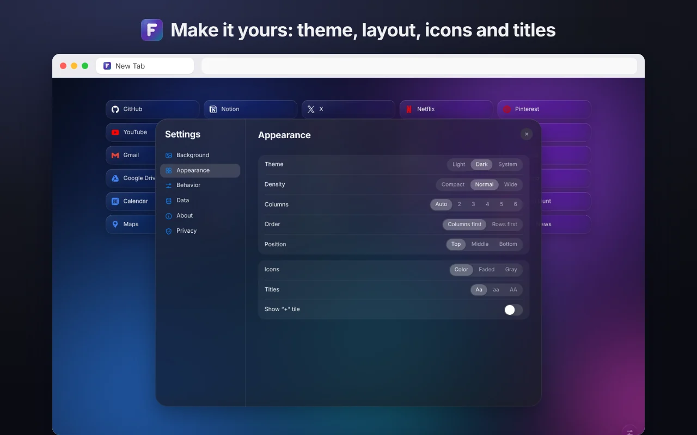
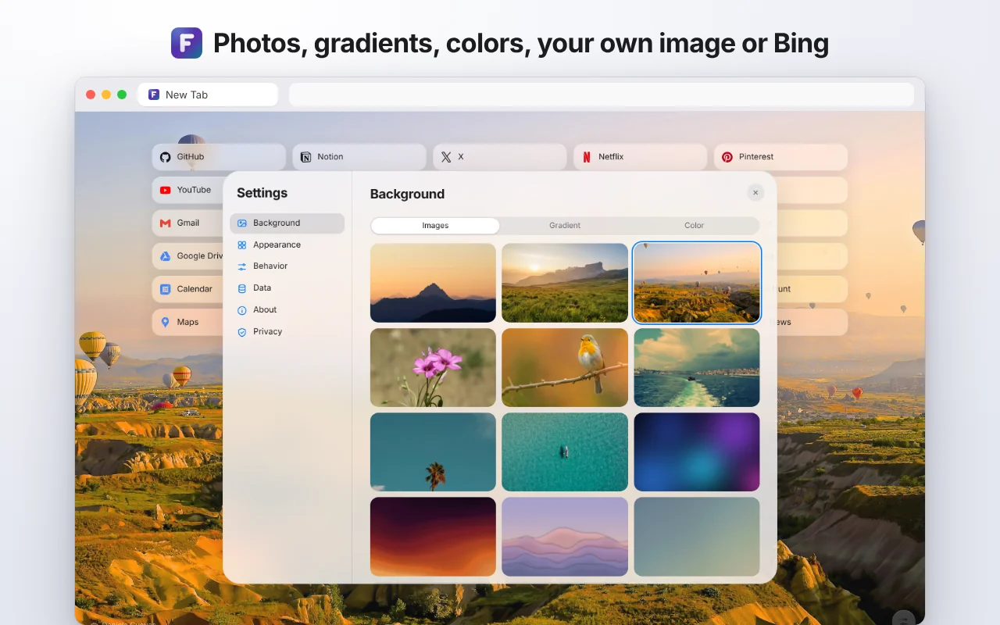

<div align="center">


# Flit New Tab

**Fast Links, Instant Tab.**<br>
Your favorite bookmarks, the moment you open a tab — fast, beautiful, private.

[**Add to Chrome — it's free**](https://chromewebstore.google.com/detail/ojjhpknoaagdmjedhcimcickmmphnnbj)

[](https://chromewebstore.google.com/detail/ojjhpknoaagdmjedhcimcickmmphnnbj)
[](https://chromewebstore.google.com/detail/ojjhpknoaagdmjedhcimcickmmphnnbj)
[](LICENSE)



</div>

Flit replaces your browser's new tab page with the links from one bookmark folder. Edit them anywhere in the browser and the page follows. No accounts, no feeds, no clutter.

## Features

- **Instant** — the page appears before anything loads. No flash, no waiting.
- **Your bookmarks** — links live in a normal folder (“Flit”, under Other bookmarks). Rename or move it; Flit keeps track. It syncs like any bookmark.
- **Quick to manage** — right-click to edit, copy or delete (with undo), paste a link to add it, drag to reorder, Alt+1–9 to open.
- **Beautiful backgrounds** — photos credited to their photographers, abstract wallpapers, gradients, colors, your own image or Bing's image of the day. Dim and blur to taste.
- **Your look** — columns or rows, density, position, light/dark/system theme, faded or gray icons, lowercase or UPPERCASE titles.
- **Back up and restore** — choose what goes in the file: settings, links, your image.
- **English and Turkish** — more languages welcome.

<table>
  <tr>
    <td></td>
    <td></td>
  </tr>
  <tr>
    <td></td>
    <td></td>
  </tr>
</table>

## Install

**[Chrome Web Store](https://chromewebstore.google.com/detail/ojjhpknoaagdmjedhcimcickmmphnnbj)** — one click. Also works in Edge, Brave, Arc, Opera, Vivaldi and other Chromium browsers (version 120+).

From source:

1. Download or clone this repository.
2. Open `chrome://extensions` and turn on **Developer mode**.
3. **Load unpacked** → choose the `ext` folder.

## Privacy

Flit doesn't collect, sell or share anything. No accounts, analytics, ads, trackers or remote code. By default it makes no requests to the internet; the only optional one is Bing's image of the day, after you turn it on. Full policy: [PRIVACY.md](PRIVACY.md) (also in Settings › Privacy).

## Development

There is no build step: `ext/` is the extension.

```sh
npm install
npx playwright install chromium
npm test          # locale checks + an end-to-end run in Chromium
npm run test:fast # locale checks only
```

How the code is organized, and the rules it follows, are in [AGENTS.md](AGENTS.md).

### Adding a language

Copy `ext/_locales/en` to `ext/_locales/<code>`, translate the messages, and add the language to `LANGS` in `ext/js/i18n.js`. `npm test` tells you if a key is missing.

## Photos

Bundled photos are from [Unsplash](https://unsplash.com) under the Unsplash License; each one credits its photographer on the page.

## License

[MIT](LICENSE) © 2014–2026 Burak Garcı
